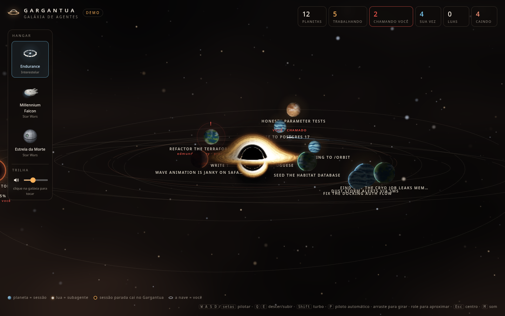
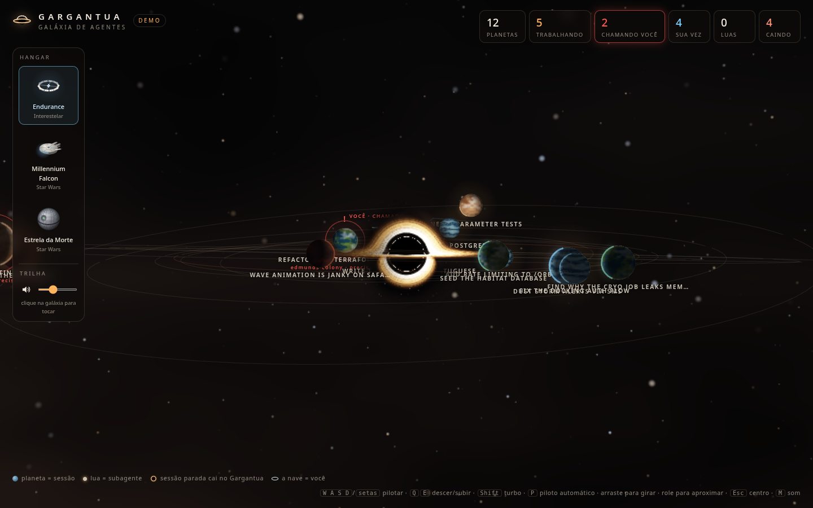
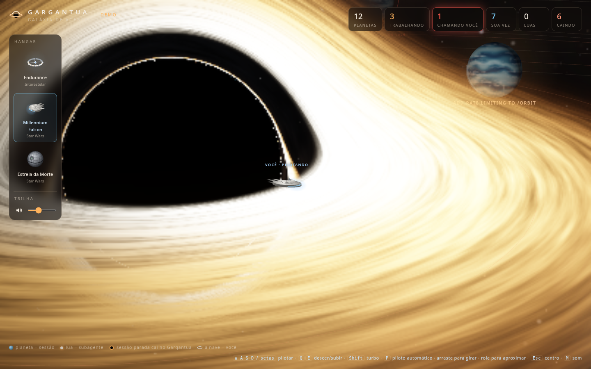
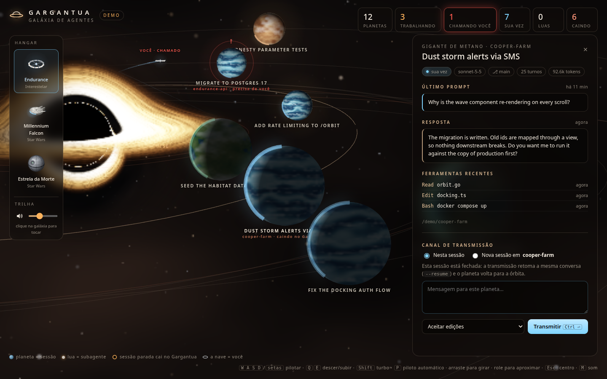
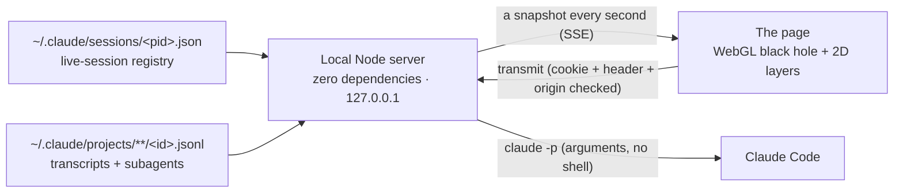

<h1 align="center">Gargantua</h1>

<p align="center"><b>An <i>Interstellar</i>-inspired galaxy for your AI coding agents.</b><br>
Every Claude Code session is a planet orbiting a ray-traced black hole, its subagents are moons,<br>and you fly the ship. Sessions left idle slowly spiral into the event horizon.</p>

<p align="center"></p>

## Quick start

```bash
git clone https://github.com/adrianoads910-max/gargantua
cd gargantua
npm start            # your real Claude Code sessions (zero dependencies, Node 18+)
npm run demo         # a fake galaxy with every state, nothing runs
```

It opens `http://127.0.0.1:4848`. Use `--port <n>` for another port and `--no-open` to skip the browser.

## What you see

| | |
|---|---|
| **Gargantua** | A Schwarzschild black hole ray-marched in WebGL: light bends around it, so the far side of the accretion disk shows above and below the shadow, and the stars behind it are lensed. The hole's alpha is an occlusion mask, so a planet passing behind it is really hidden. |
| **Planets = sessions** | Every Claude Code session (open, or touched in the last 3 hours) is a planet. Sessions of the same repository share a kind of world (ocean, ice, desert, volcanic…). A planet spins faster while its session works, and its clouds drift over the surface. |
| **Moons = subagents** | Each subagent a session started recently is a moon; it glows while working. |
| **The fall** | A session still for more than 5 minutes starts to spiral in. Near the hole time dilates, so it slows down, stretches toward the hole, reddens and fades. If the session wakes up, the planet climbs back to its orbit. `?fall=10` plays the whole fall in 10 minutes. |
| **The ship** | You. On autopilot it flies to the session that needs you (a question or a permission prompt), otherwise to where you last spoke. Pick the **Endurance**, the **Millennium Falcon** or the **Death Star** in the hangar; each is drawn in 3D, so from the side you see its profile. |
| **Event horizon** | Pilot too close and the ship is captured: the controls stop answering, it stretches and fades into the hole, then comes back through the tesseract at the edge of the galaxy. |

<p align="center"> </p>

## The panel and the transmission channel

Click a planet: the camera flies to it and the panel shows the session's status, model, branch, **last prompt**, **reply** (live while it works), recent tools and its subagents. Click a moon for that subagent's task and reply.

At the bottom, **Transmit** sends a prompt:

- **To this session.** A closed session resumes the same conversation (`claude -p --resume`). A session open in an editor or terminal is never written to at the same time: a sibling planet is forked with its whole context (`--fork-session`).
- **To a new session in the repository.** `claude -p` in that folder; it appears as a new planet.

You choose the permission mode (accept edits, plan only, auto or default). With nobody there to approve, anything that would ask for permission is denied. `bypassPermissions` is never accepted from the page.

<p align="center"></p>

## Controls

| Key | |
|---|---|
| `W A S D` / arrows | pilot the ship (relative to the camera) |
| `Q` / `E` | down / up |
| `Shift` | boost |
| `P` | autopilot on/off |
| `Enter` | near a planet: open its channel |
| drag / wheel | orbit / zoom the camera |
| `Esc` | back to the centre |
| `M` | soundtrack on/off (volume under the hangar) |

## How it works



1. **Read, never write.** The server reads what Claude Code already keeps on disk. It never reads credentials (the `*.key` files next to the registry are skipped). Only the transcript tail that changed is parsed.
2. **One snapshot per second** over Server-Sent Events: status (working, needs you, your turn, closed), current tool, last prompt, subagents.
3. **Four layers:** the unbent sky, the bodies behind the hole, the hole itself (its alpha hides what is behind it), the bodies in front.

## Security

- Binds to `127.0.0.1` only, with a Host allowlist (no DNS rebinding) and a strict Content Security Policy.
- Sending a prompt needs a per-run `SameSite=Strict` cookie, a custom header and a local Origin, so no other website can trigger it.
- The prompt is passed to `claude` as a single argument, never through a shell. Secrets that look like tokens are masked in what the page shows.

## Development

```bash
npm test             # zero-dependency tests
npm run demo         # every state, for visual work
```

## Credits

- Inspired by *Interstellar* (2014) and its black hole, Gargantua. Built alongside [pokemon-coworking](https://github.com/adrianoads910-max/pokemon-coworking) and the original [coworking-agents](https://github.com/ChaconLucas/coworking-agents) by Lucas Chacon.
- Soundtrack: *Into the Starfield (Main Theme)* from *Starfield* (Bethesda Softworks), composed by Inon Zur. It belongs to its owners and is included only for personal, non-commercial use.
- *Interstellar*, *Star Wars*, the Endurance, the Millennium Falcon and the Death Star belong to their owners. This is an unofficial fan project; the ships are drawn procedurally.

MIT License (code only).
